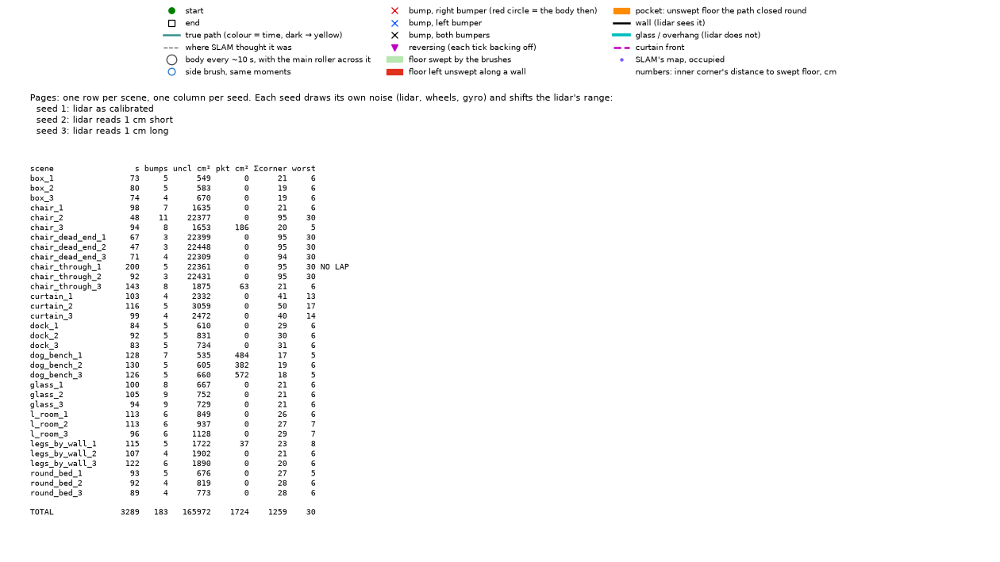
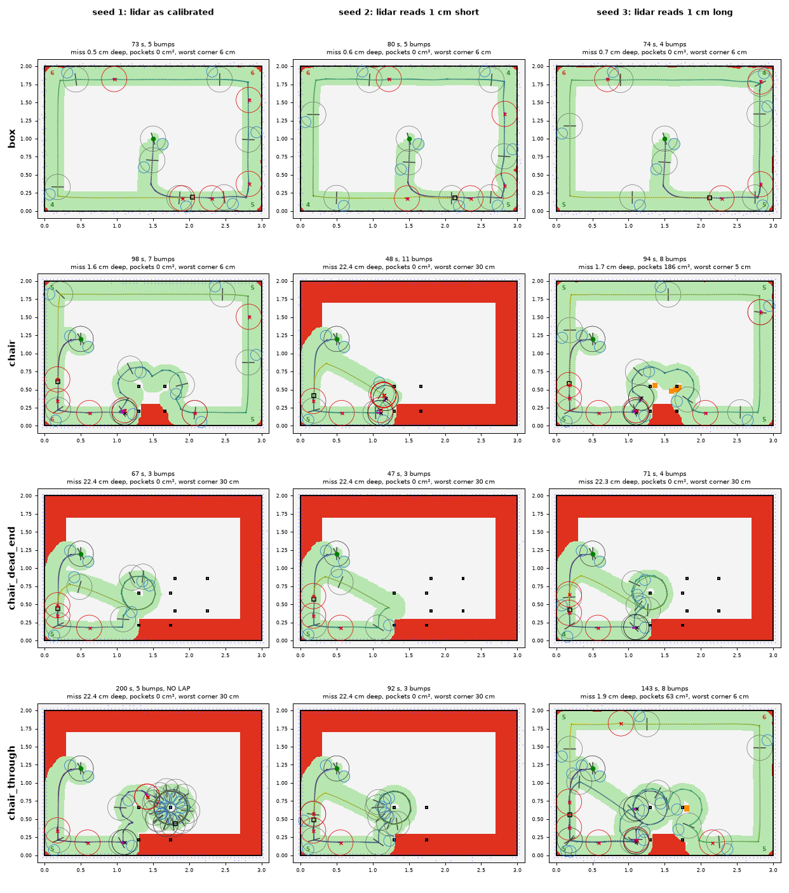
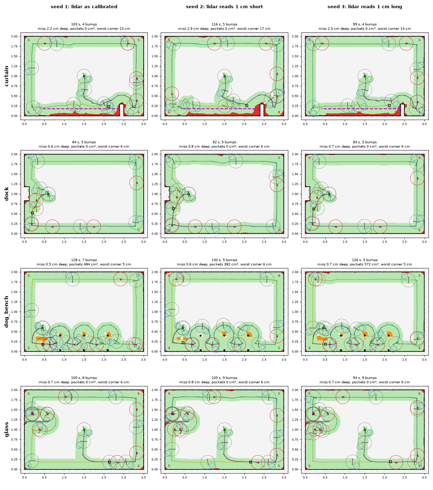
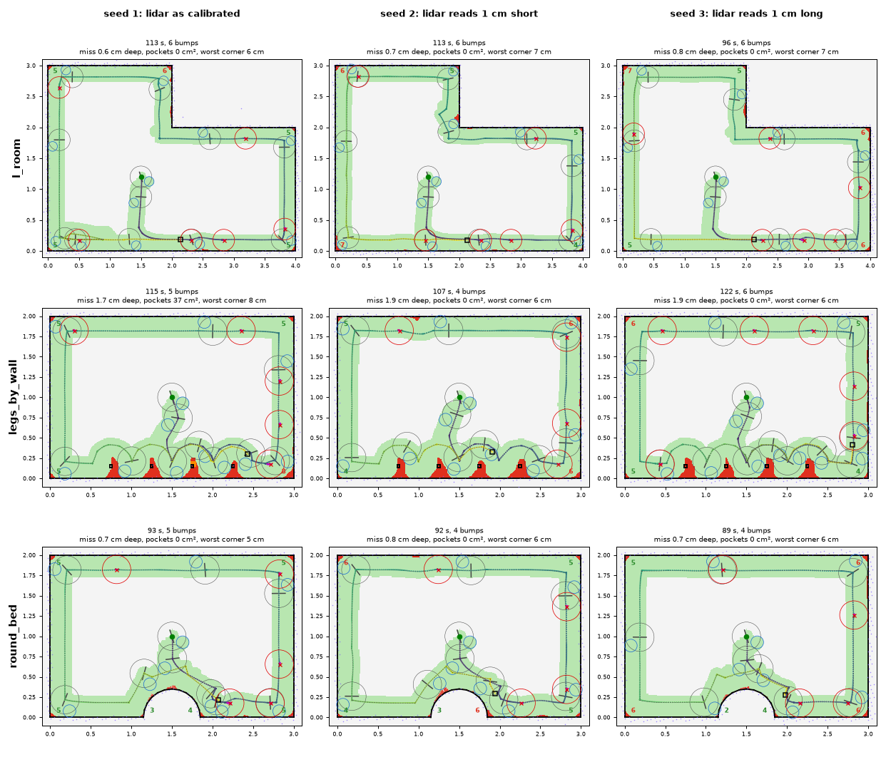
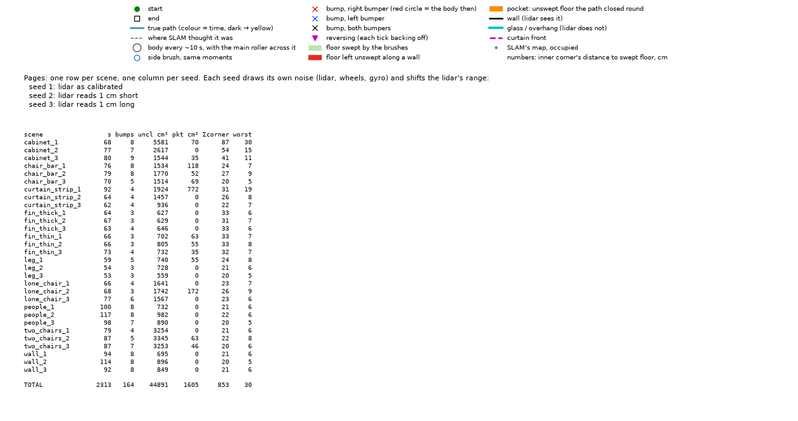
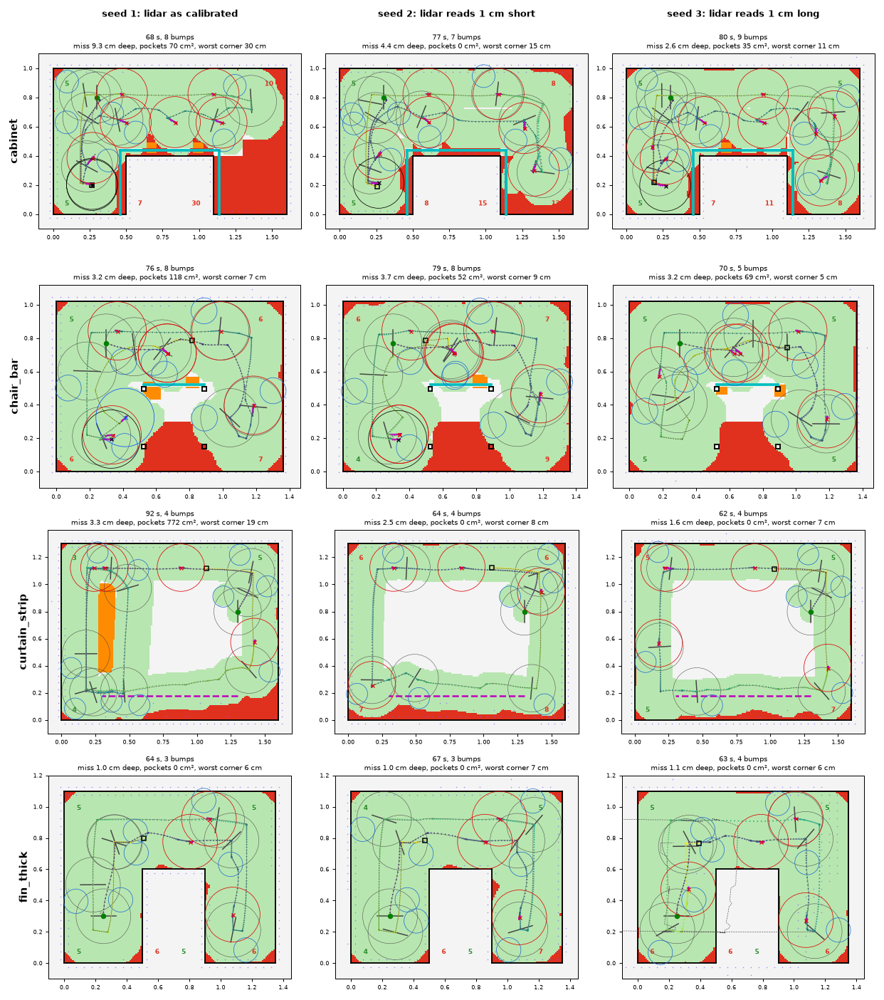
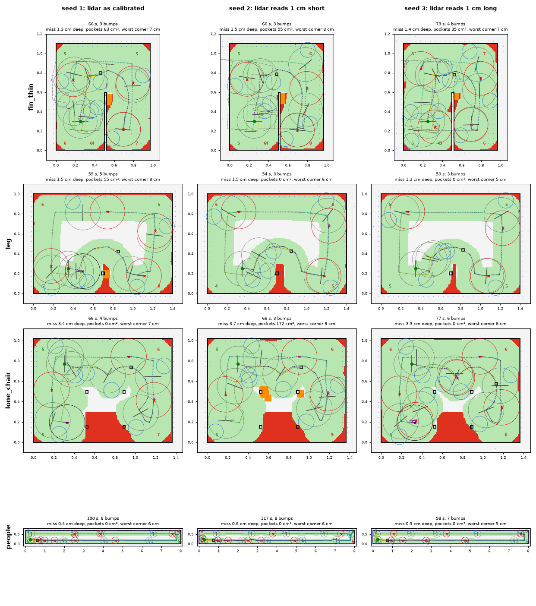
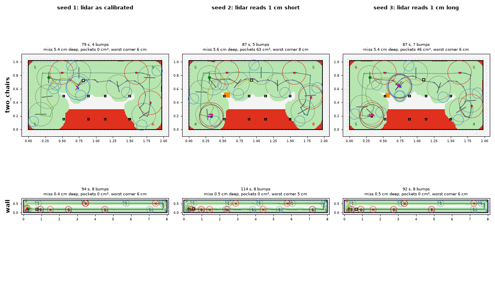

# Sweep bench: the simulation, the scenes, the metrics, sim2real

How the corner sweep (`wall_follow`) is developed without the robot: what the simulator models,
which scenes it is scored on, what the numbers mean, and where the bench and the real robot are
known to differ. To run it, see [§6](#6-running-it). The reference render of the current code is in
[§7](#7-reference-render).

Names like sweep7 or flat1 are recordings of the real robot that the scenes and the models were
measured from. They are not in this repo.

## 1. What runs, closed loop

```
 scene (polygons, legs, glass, curtain)
   │ rasterised to a 1 cm map
   ▼
 SangamIO MockRobot ──sensor_status 110 Hz, lidar ~6 Hz──► SangamIO wire format
   ▲                                                         │
   │ drive(v, ω)                                             ▼
 motion limits ◄── exploration Session (wall_follow) ◄── dhruva-slam decode → SLAM
                   ticked at loop_rate_hz (10 Hz)           (pose, scans, map)
```

The bench (`dhruva-lab/src/bin/sweep`) runs **the code that runs on the robot**, all as libraries
in one process, on a simulated clock and as fast as the CPU allows:
- The robot is `sangamio/src/devices/mock`, configured by `sangamio/mock_bench.toml`.
- The software is configured by `dhruva-slam/dhruva-v8.toml` unchanged.
- Messages cross the real wire format.
- The bench repeats the exploration thread's sequencing: lidar settle, motors-on settle, a pause
  after each contact, and the motion limits.

A run is deterministic per seed: the same seed replays the same path exactly (a test checks
this), so two settings compare on equal noise. Scoring uses the **true** path, not SLAM's belief.

## 2. The simulated robot (SangamIO mock)

| Part | Model | Measured from |
| --- | --- | --- |
| Body | disc, Ø 35 cm; collision stops it | tape measure |
| Drive | unicycle (v, ω); nothing for 80 ms, then first order with τ 0.12 s to 90% of the command | step responses in sweep8 |
| Encoders | wheel ticks, 6.8 cm wheels 23.5 cm apart (dhruva-v8.toml assumes 23.8), slip noise | measured on the robot (the vendor's 3616 ticks per turn at 0.0604 mm gives a 6.95 cm wheel); ticks per metre from flat1 |
| Gyro | 0.0100 °/s per LSB, deadband ±1 °/s in the MCU (dhruva-slam assumes 0.01025: the 2.5% gap is real) | recordings |
| Lidar | Delta-2D: 360 beams per revolution at 6.03 Hz, clockwise, each beam cast from where the robot is when it is taken (motion skew). Mount 11 cm behind centre, 2.5 cm optical offset, 15 cm–8 m. Noise 0.5 mm + 3 mm/m, 5% dropped beams | recordings |
| Bumpers | left and right arcs of the shell; pressed when the arc 1 cm out touches anything; a thin leg presses it | shell geometry; zones not yet confirmed on the robot |
| Glass | in the map but not in the lidar mask: solid to the body, invisible to the lidar | — |
| Overhangs | too low for the body: the room ends at the lip (the edge scored); the band behind it is solid but clear to the lidar, which sees what holds it up. The floor under it is not scored | — |
| Curtain | a band of folds the body drives through; a beam crossing it returns with a probability, 27% of those dim | sweep7 (partly, see §5) |
| People | Poisson legs round the lidar each revolution (`legs = 2` in `people`) | not measured |

Per seed the lidar's range bias is shifted by 0, −1 or +1 cm (`RANGE_BIAS` in `run.rs`): the
software's idea of the lidar offset is off by up to a centimetre on the real robot too.

## 3. The scenes

Two kits, `--kit rooms` (default) and `--kit primitives`. Scenes live in
`dhruva-lab/src/bin/sweep/scene.rs`; each is a room polygon wound anticlockwise (the floor is on the
left of every edge), obstacles, and a start pose by a wall with the wall on the right.

**Rooms**: small rooms after what the real runs met:

| Scene | What it tests |
| --- | --- |
| `box` | walls and four inner corners |
| `l_room` | an L: five inner corners and one outer |
| `dock` | just undocked, the 35 × 12 cm dock on the wall behind (sweeps 1, 4, 5, 8 went wrong here) |
| `curtain` | sweep7: folds 3–18 cm out from a wall, mostly seen; the body drives through to the wall |
| `legs_by_wall` | sweep6/7: legs 15 cm off the wall every 0.5 m, too close to pass behind |
| `dog_bench` | 1.2 × 0.4 m on six 3 cm legs against a wall, high enough to drive under |
| `chair` | sweep8: a chair 20 cm off the wall; its legs are 34 and 32 cm apart inside, too narrow for the body |
| `chair_through` | a wider chair (42 cm inside) 20 cm off the wall: in under it from one side, out the other |
| `chair_dead_end` | the same chair with a second one beside it, offset so its leg blocks the way out: in, sweep, back out |
| `round_bed` | sweep6: a half disc of 35 cm radius against the wall, an outer curve |
| `glass` | a 0.6 m glass fin out of a wall: felt, not seen |

**Primitives**: one move per scene, so a rule change shows where it helps and where it hurts:

| Scene | What it tests |
| --- | --- |
| `wall` | 8 m of wall, a U-turn at each end |
| `fin_thin` | round the end of a 2 cm partition (a desk side): a half turn about one point |
| `fin_thick` | round a 40 cm block: two outer quarter turns, a short side between |
| `leg` | a 3 cm leg too near the wall to pass behind |
| `cabinet` | a plinth whose top overhangs it by 4 cm: the lidar sees the plinth, the shell meets the top, whose lip is the edge to sweep |
| `lone_chair` | a chair 14 cm off the wall (sweep8): round its legs as one thing |
| `chair_bar` | the same chair with a stretcher below the lidar: seen open, bumped |
| `two_chairs` | two chairs 22 cm apart, narrower than the body: round both as one |
| `curtain_strip` | a curtain 15 cm deep before a wall, mostly seen: into it to the wall |
| `people` | the 8 m wall with people walking by |

## 4. The metrics

Computed by `score.rs` from the true path and the v8's brushes:
- The side brush is a 7.8 cm disc, 10.5 cm ahead and 11 cm right of centre.
- The main roller is a 16 cm strip across the centre.

Every 1 cm cell they pass over counts as swept.

| Column | Meaning | Good |
| --- | --- | --- |
| `lap` | the strategy closed its lap by itself (rather than timing out or getting stuck) | yes |
| `s` | seconds to close the lap | — |
| `bumps` | new bumper presses | few, and only on what the lidar cannot see |
| `miss cm` | **the main metric.** Each edge (walls and obstacles) is sampled every 1 cm. A sample measures how far in from the edge the swept floor starts, capped at 30 cm. This is the mean depth: the area between the sweep and the edge, per metre of edge | < 1 cm |
| `corner` | the worst inner corner: distance from the corner to the nearest swept floor | ≤ 5 cm. The round side brush can do no better in a right angle |
| `pkt cm²` | pockets: unswept floor the path closed a loop round, too small for the body (inside a loop round a leg). Each needs a trip back | 0 |
| `loiter` | the longest time the path stayed inside a 1 m circle | low |
| `cost` | the single number the climb minimises (below) | low |

One point of `cost` buys any one of:
- 1 cm of mean miss depth;
- 100 cm² of pockets;
- 3.3 cm of a corner beyond 5 cm;
- 2 bumps;
- 30 s;
- 10 s of loitering beyond 30 s.

A lap not closed costs 10.

Floor no brush can reach from a pose the body fits at is not scored as missed, and the floor
under an overhang is not floor at all (the lip is the edge).

## 5. Sim2real: where the bench and the robot differ

Known differences, with what each could hide:

- **SLAM latency.**
  - On the bench, SLAM takes no time. On the R16 a scan takes tens of ms, so the pose a tick
    reads is older.
  - The 2 cm hover gap trusts that pose, so on the robot expect more grazing.
- **Bumper.**
  - The mock triggers 1 cm before contact and stops the body dead: no compliance, no pushing.
  - The real shell gives a few mm and the wheels push on until the MCU reacts.
  - The bumper zones' bit map is not confirmed on the robot yet.
- **Curtain.**
  - The mock's fabric is a random scatter of returns.
  - Real fabric (sweep7) is a nearly continuous surface: roughness p90 1.1 cm, with ~27% dim
    returns (intensity < 100, where walls give 2–6%).
  - The mock returns 27% of fabric beams dim (quality 30–100), as sweep7 did (f33a6d1). Its
    fabric is still scattered folds, not sweep7's continuous surface. The sweep tells fabric by
    those dim returns and follows the wall behind it (cf89f9e), so it depends on the 27% holding
    on other curtains.
- **Floor.** There is no carpet, no threshold and no wheel slip on a rug edge. Cliffs are in the
  mock but no scene has one.
- **Timing.**
  - Ticks fall on the mock's 110 Hz steps.
  - Commands skip TCP.
  - The lidar spins from t = 0 instead of booting for ~30 s.
- **Tuned on the bench only.** Speed (0.3 m/s, slowing to 0.12 near obstacles), turn rate
  (0.8 rad/s) and the gains have never driven the real robot. The real runs sweep1–8 used older
  rules.

What transfers well: the geometry (body, brushes, lidar mount all measured), the drive's lag,
the lidar's skew and noise, and the exact software stack.

## 6. Running it

Needs only this repo: the bench builds `dhruva-slam` and `sangamio` (feature `mock`) from the
sibling folders and reads `dhruva-slam/dhruva-v8.toml` and `sangamio/mock_bench.toml`. The
scenes are in code. From `dhruva-lab/`:

```bash
cargo build --release --bin sweep
./target/release/sweep --kit primitives --seeds 3                 # table + total cost
./target/release/sweep --kit primitives --only cabinet --seeds 3 --dump /tmp/wf   # one scene, JSON per run
./target/release/sweep --kit rooms --set speed=0.2,tuning.hover_gap=0.03          # try settings
./target/release/sweep --kit primitives --seeds 3 --climb 40      # hill-climb [exploration.wall_follow]
```

- `--only` takes one scene name, not a list.
- `--reasons` prints the seconds spent in each strategy status.

To iterate on the algorithm, change `dhruva-slam/src/exploration/wall_follow.rs` (the rule) or
the `[exploration.wall_follow]` section of `dhruva-slam/dhruva-v8.toml` (its settings), rebuild,
and compare the total cost with the reference below on the same seeds.

Render dumped runs ([uv](https://docs.astral.sh/uv/) fetches numpy and matplotlib):

```bash
uv run -q --with numpy --with matplotlib tools/wf_sim_plot.py /tmp/wf --out /tmp/wf.png
```

It writes an overview (`/tmp/wf.png`: the legend, what each seed changes, a table of every
run) and pages of panels (`/tmp/wf_1.png`, …): a row per scene, a column per seed, `--rows`
scenes a page (4). The marks:
- Green floor is swept; red is missed along an edge; orange is a pocket.
- The line is the true path (coloured by time); the dashed line is SLAM's belief.
- Circles are the body and brush every ~10 s.
- Crosses are bumps: red right, blue left, black both.
- Each inner corner carries its distance to swept floor.

Each kit with 3 seeds takes a few minutes on an M-series Mac. Running daemons in real time
is never needed for this.

## 7. Reference render

Both kits with the `wall_follow` of cf89f9e, 3 seeds, default settings: total cost
**rooms 573.1** (11 scenes, with the two new chairs; the 9 older ones total 285.4) and
**primitives 332.8**. A change should beat these on the same seeds.

Rooms kit: the overview (legend, what each seed changes, every run), then the pages.






Primitives kit:






Open:
- **Chairs.** The sweep never goes under a chair, not even the 42 cm one: it rounds the legs
  as one outline. On 2 of 3 seeds of `chair_through`, all of `chair_dead_end`, and `chair`
  seed 2, it closes its lap early (47–71 s) after circling the legs and leaves most of the
  room. The scenario test skips the two new chairs until that is fixed.
- `curtain` runs out of time on the test's seed 7.
- `dog_bench` leaves 380–570 cm² of pockets between its legs.
- `cabinet` skips the bay beside it on 1 of 3 seeds.
- The corner at the curtain's end stays 13–17 cm.

## 8. What was tried (lab notes)

The climb history of `wall_follow` on this bench, oldest first. Numbers are from the seeds and
code of their day; the current numbers are in §7.

- a5c121c: one greedy rule (keep the edge point 2 cm off; glass bumps become a remembered
  line). 09ad95c climbed it faster (0.17 m/s, 0.67 rad/s on the spot) on seeds 1-3, held on
  4-6: every lap closed, mean run 97 s (was 112), room corners 5-6 cm, under 1 cm of floor
  missed along walls in most scenes, bumps only at glass (plus rare bumper chatter grazing a
  leg or the dock's corner). Faster than 0.17 bumps more and loses laps. Not deployed.
- The bench now also charges **pockets** (floor left inside a loop round a leg, 69a45aa) and
  scores only floor (b0cf396). Re-climbed with them (f6cec04: 0.8 rad/s, k_turn 2.0, spin
  above 0.35 rad, 5 cm back-off): 6-seed cost 403 → 361, held-out 197 → 174, pockets
  158 → 87 cm². The lap now follows on 25 cm over its seam (0db1140), which closed the strip
  left where the robot first reached the wall. Renders draw the true brush footprint,
  bumps, reversing and SLAM's map (44d1995).
- Left on the bench: the curtain's 17 cm strip (the sweep never pushes into fabric it sees;
  doing so would need a rule for soft obstacles), and the 12 cm step beside the dock, 11 cm.
- **Primitives kit** (`--kit primitives`, 2026-10-20): one obstacle per scene, from the
  obstacles the real runs kept meeting: an 8 m wall, people walking by, thin and thick fins, a leg, a
  lone chair, a chair with an unseen stretcher, two chairs 22 cm apart, a cabinet whose top
  overhangs its plinth unseen, and a curtain strip. Mean cm missed along walls over 5 seeds:
  under 1.5 cm everywhere but cabinet 3.6, chair_bar 3.1, lone_chair 3.3 (behind it is
  unreachable), two_chairs 5.3 and curtain_strip 5.2.
  - What got it there: held contacts, a steady-scan filter (walkers), the lap closing on
    the turn round (`LAP_TURN`, 9153efc), and unseen bumps remembered where the bumper says
    and only ±4 cm wide (8980112: cabinet 19 → 3.6 cm, chair_bar 15 → 3.1).
  - A 40-trial climb on it found no better settings, nor did 30 trials on the rooms kit.
    A climb on the rooms kit from 0.24 m/s settled back at 0.18 m/s, and those settings
    fail 3 primitives runs (cost 560 → 714); faster than 0.17 m/s bumps and misses
    more. The curtain stays open: marking fabric the body enters as soft did not get the
    robot through (the deeper folds read as blocking ahead). Then aiming 5 cm into fabric once
    felt helped the strip on 2 of 3 seeds, but the rooms curtain never triggers it. Felt from
    any depth, it set off bump storms and runs out of time. Telling fabric by its returns
    through SLAM's map (drop scan points on cells it has free) fixed the strip (worst
    corner 18 → 5-9 cm) but also dropped chair legs. At 5 cm cells, beams passing beside a
    leg mark it free, so legs, chairs and the dog bench failed. The finer rule (a beam of the
    last 3 scans passed within 5 mm and went 4 cm on) did the same to legs and fin ends and
    did not help the curtain. Rules by what the lidar sees all trade legs for fabric on the
    bench. sweep7 shows why: the real fabric is a nearly continuous surface (roughness
    p90 1.1 cm) with about 27% dim returns (intensity < 100; walls, legs and chairs 2–6%),
    not the bench's 15 cm random scatter. Next: the mock models
    the curtain as a surface with dim returns and gives intensity; the sweep pushes into
    patches of dim returns.
- 2026-10-20, mock wheel base set to the measured 23.5 cm (was dhruva-v8.toml's 23.8): totals
  over 3 seeds rooms 267 → 279, primitives 344 → 350, within seed noise. Then 20-trial climbs on
  single scenes:
  - dog_bench went 48 → 40 (hover 3 cm, gentler gains). On the full kits that gives rooms 279
    (same) and primitives 376 (worse).
  - curtain went 47 → 41 (0.196 m/s). On the full kits: rooms 323, primitives 391 (both worse).

  Neither was kept. Settings tuned for one obstacle cost elsewhere, so the remaining misses are
  the rule's, not its settings'.
- 2026-10-20, cabinet: after an unseen bump beside a seen edge, hover that edge farther off by
  the measured depth (~5 cm) until the robot turns 45° off the edge's direction. Along the top
  it worked: 2 bumps instead of 4. But held 5 cm farther out, the robot passed the 45 cm bay
  right of the cabinet on all 3 seeds (baseline: 1 of 3), so primitives went 351 → 370. Not
  kept. Getting into that bay is the outer-corner problem again.
- 2026-10-20, `wip/outer-corner` 84da6ab: the outer-corner turn remembers the heading it just
  rounded to (a face too short to fit, met within 10 cm, runs that way) and the overhang a bump
  felt (gap and corner clearance grow by it for 0.6 m of travel). fin_thin pockets went 45–63 →
  0/57/0 cm²; rooms 271, primitives 353. The cabinet bay is still skipped on 2 of 3 seeds: the
  mock's bumper fires 1 cm early, so the overhang measured is short and the body clips the
  top's corner on the turn. Deferring the planned touch beside an overhang made primitives 396.
- 2026-10-20, speed (`wip/outer-corner` 07aa3f6, 2cc2efc). A flat 0.22 m/s kept walls as tight
  but re-pressed the wall 2–4 times after each planned touch (the shell, still angled in, met
  it again); turning 0.2 rad off instead of 0.1 fixed that. Then regulated speed: 0.3 m/s with
  the way clear, down to 0.12 as the nearest point in the body's path comes within
  `slow_within` beyond `front_look`. 6 seeds, rooms + primitives: 0.17 flat 1417; regulated
  0.3 with slow_within 0.2 → 1295, 0.3 → 1269 (3 seeds put 0.2 first: within noise). At
  0.17 m/s regulation only costs time. Regulated 0.26 or a flat 0.22–0.26 were worse.
- 2026-10-20, curtain (`wip/outer-corner` 1045704, cf89f9e). The steady-scan filter keeps each
  return's quality. A 5 cm cell is fabric when at least 15% of 8 or more returns in it are dim
  and two neighbours agree. Fabric points are seen 15 cm deeper on the wall side, so the robot
  follows the wall behind the curtain, and a bump there marks only 15 cm. Dropping fabric
  points lost the edge (loops, timeouts); shifting them along the beam or 20 cm deep was worse.
