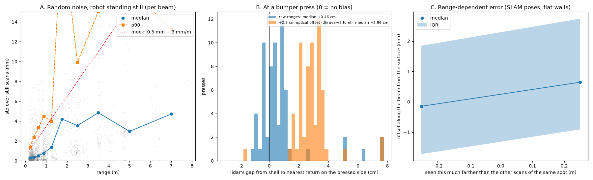

# The real lidar's errors

How wrong is the v8's Delta-2D, and is the sweep bench's ±1 cm range bias (per seed) a fair
model of it? `lidar_err.py` reads every labelled run (the 8 in the project's
`captures/catalog`). It uses the robot's own SangamIO recordings and SLAM's final trajectory
of each, and prints `lidar_err.txt` and plots `lidar_err.png`. The recordings and their
readers (`tools/py/`) live outside this repo, so the committed txt and png are the record.



## A. Random noise (robot standing still)

Per-beam std over windows of 15+ still scans:

| range | 0.2 m | 0.4 m | 0.6 m | 0.9 m | 1.25 m | 2.5 m | 3.5 m | 5 m |
| --- | ---: | ---: | ---: | ---: | ---: | ---: | ---: | ---: |
| median std, mm | 0.3 | 0.4 | 0.5 | 0.8 | 1.4 | 3.6 | 4.9 | 3.0 |
| p90, mm | 1.4 | 2.4 | 3.3 | 4.5 | 4.0 | 9.9 | 15 | 17 |

Small at wall-following range: under a millimetre within 1 m. The mock's 0.5 mm + 3 mm/m
is about right up close and generous beyond.

## B. Bias at a bumper press

At each press (70 in 7 runs), the next scan's nearest return on the pressed side gives the
gap from the shell (r 17.5 cm, lidar 10.5 cm behind the centre). The second-nearest return
is used, against stray points. The gap is computed as dhruva-slam does it, with
`optical_offset` 0.025 added to every range. On the 60 presses where the lidar sees what was
hit (a gap under 5.5 cm):

- **median +2.9 cm, std 0.9 cm** with the offset: walls look 2.9 cm farther than the shell
  that is touching them;
- so **about +0.4 cm on raw ranges**;
- consistent across runs, per-run medians 2.1-3.3 cm. It is systematic, not noise.

Not accounted for yet:
- **Bumper travel.** The shell moves in a few mm before the switch closes, so at a press the
  wall is that much inside the resting shell. The true bias is the measured gap plus the
  travel, so ignoring it would make the follower rub.
- **Motion.** The robot keeps moving or starts backing off between the press and the
  scan (0.12-0.5 s later).
- **What was hit.** A baseboard or a chair rail the lidar sees behind the contact reads long.

## C. Range-dependent bias

Each point of a still scan is placed with SLAM's poses and compared with the line through
other scans' points of the same spot (seen ≥ 5 s apart). Its offset along its beam is taken
against how much farther it was seen. Only still scans are used: moving ones smear walls
by motion skew and pose error.

- The binned medians within ±0.5 m are −0.2 and +0.6 mm (IQR about ±2 mm), with no visible
  trend.
- A straight-line fit does not agree. The pooled slope is −14 mm/m, and the per-run slopes
  run from −22 to +218 mm/m with both signs. These fits are driven by outliers (std 6 mm),
  not by the bulk.

So this method cannot see a range-dependent error, if there is one; any such error is small
next to B's offset. Only 5 runs have still scans with a final trajectory, and the spread in
range per spot is small (most within ±0.5 m).

## What it means

- The error is a constant offset, not noise and not range-dependent. A once-per-robot
  calibration fixes it, or an online estimate from bumps.
- The bench's ±1 cm per seed is the right shape. But the real robot may sit near +2.9 cm with
  today's config: walls look farther than they are, which makes it rub.
- Before changing `optical_offset`: compensate the press for motion, put a number on the
  bumper travel, and check against a tape measure. Two other routes are a straight wall's
  curvature (a wrong radial offset bows it) and the vendor's own value.

## Run it

```bash
uv run -q --with numpy --with scipy --with matplotlib --with protobuf --with mcap \
    --with zstandard reports/lidar/lidar_err.py --root .. > reports/lidar/lidar_err.txt
```

from `VacuumTiger/`; `--root` is the project around it (`captures/`, `data/`, `tools/py/`).
