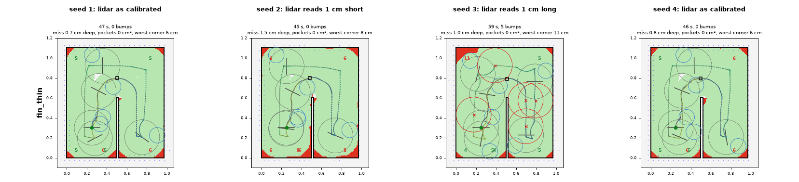
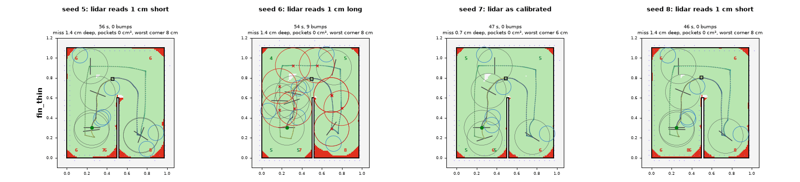
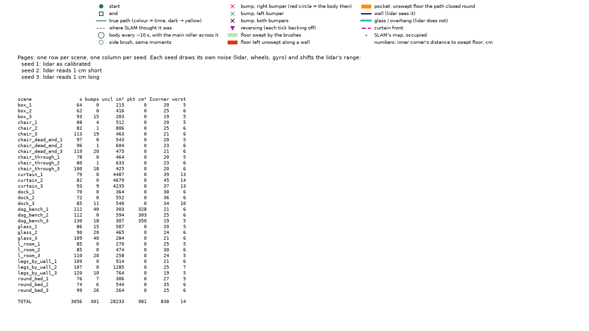
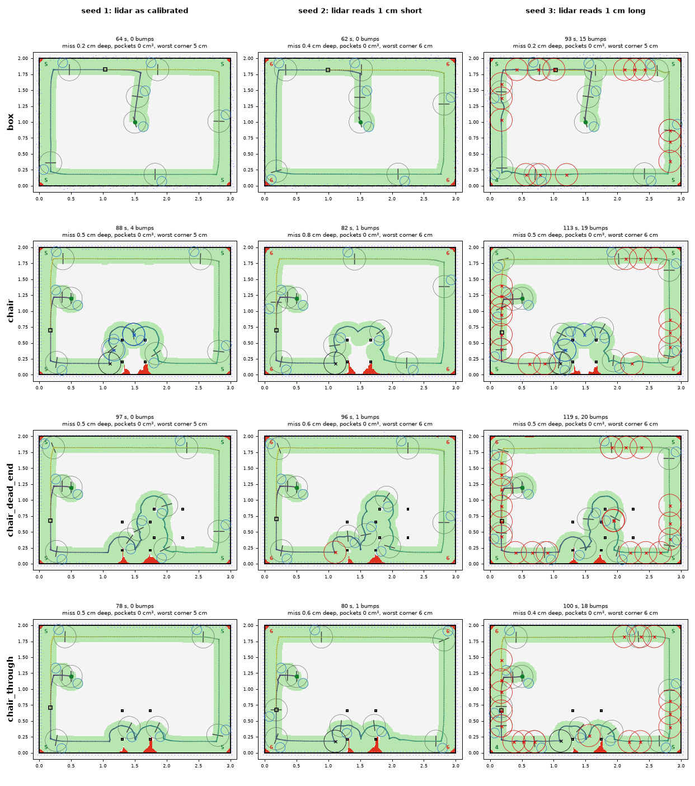
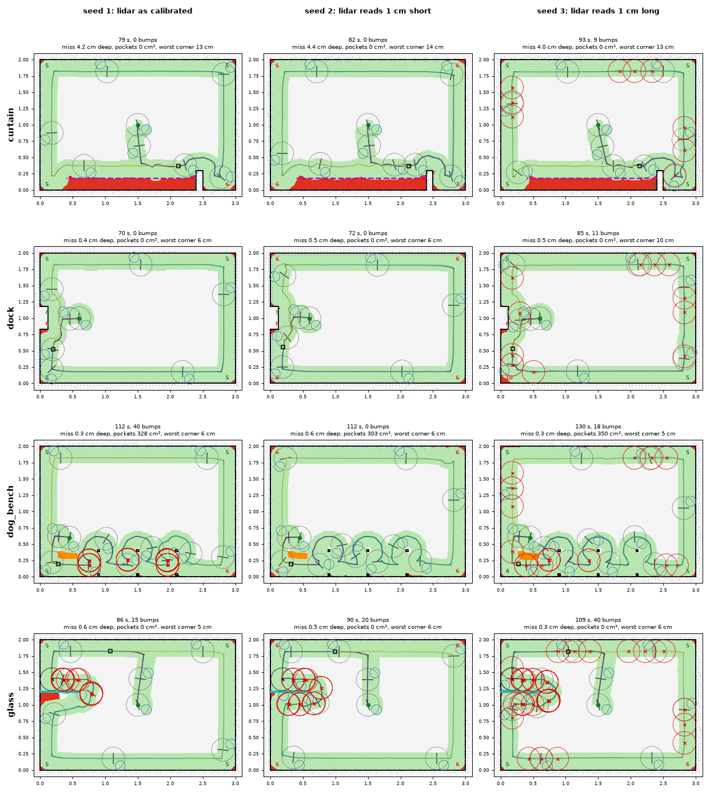
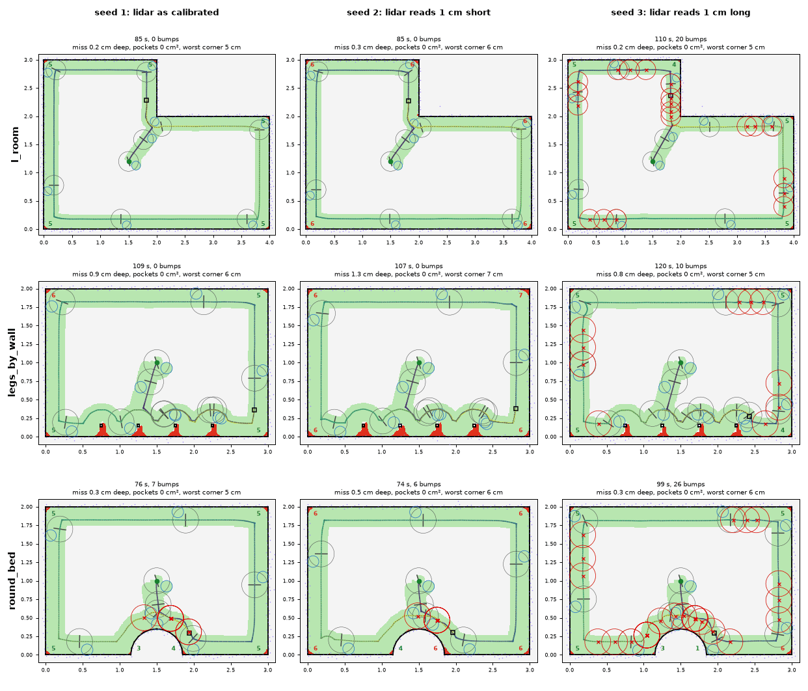
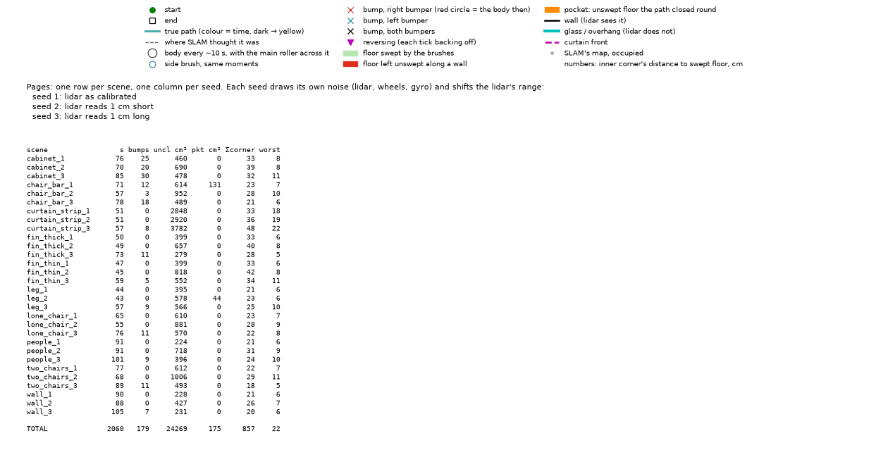
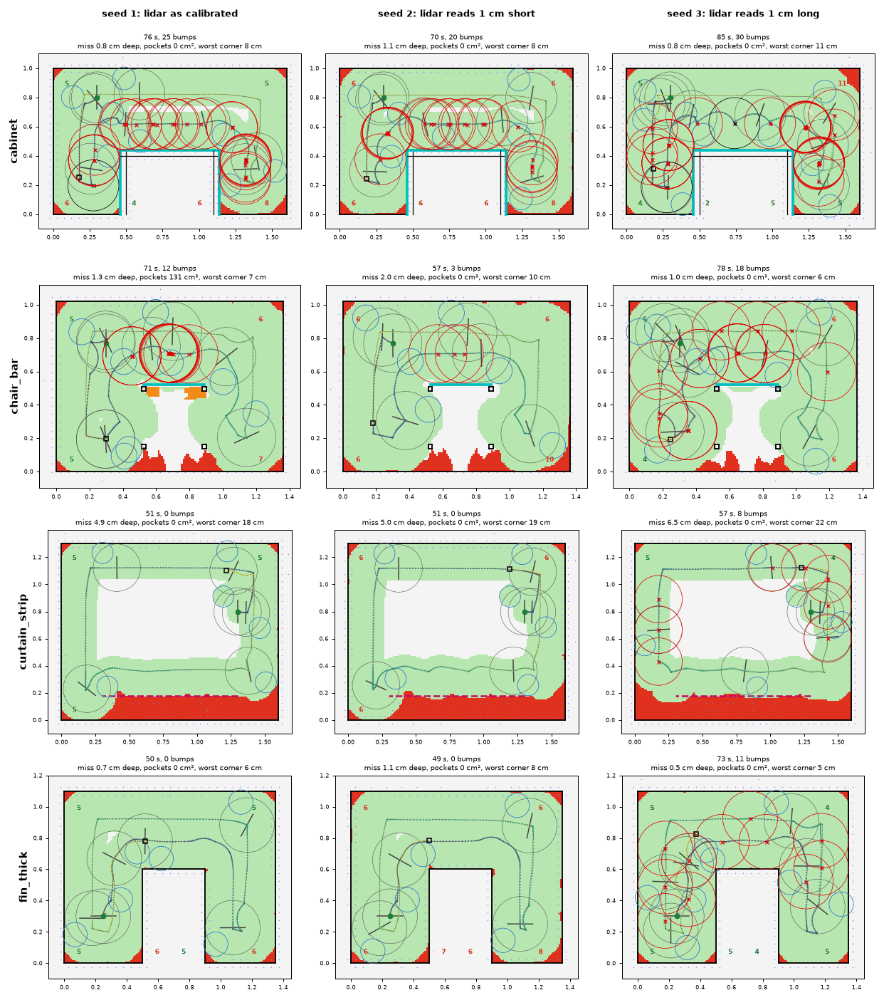
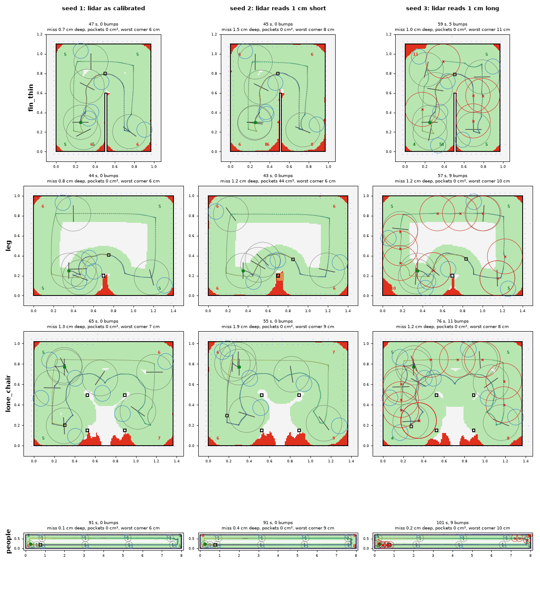
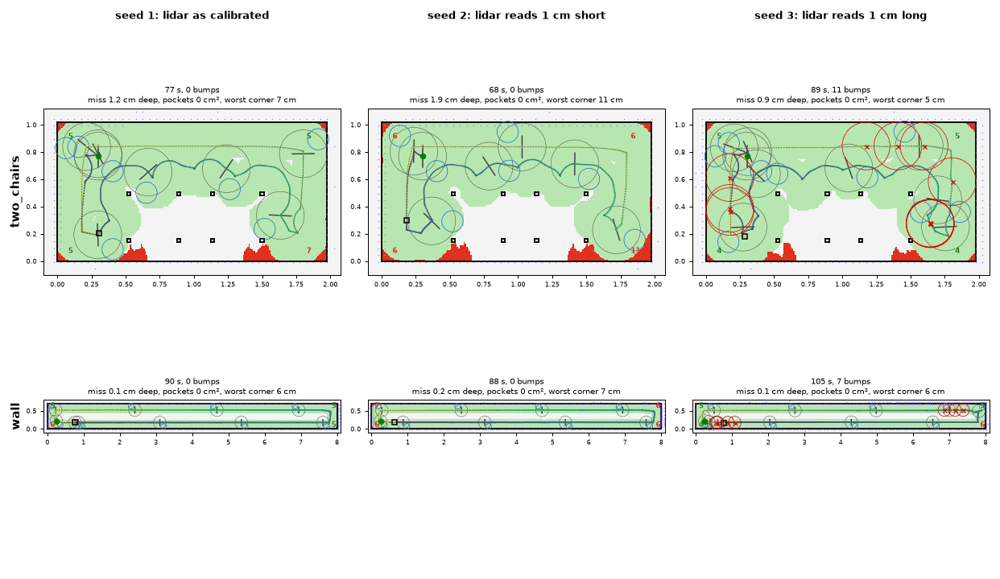

# stock_follow

The stock firmware's edge pass, ported: `dhruva-slam/src/exploration/edge/stock/`. Per beam
it reads the gap from the body to the obstacle. It follows with a few actions (Follow,
Rotation, Arc, Line, BackAlign), each with its own finish and fail tests, chained by a
transfer state machine. The setpoints are tight, the wall about 0.2 cm off the shell. After
more than two bumps along a straight they go loose, about 1.6 cm off. They tighten again at
the next corner, after a few left-only lines, or on a bump while loose. The module doc lists
where the port differs from the stock on purpose.

## Numbers (8 seeds, aa6f172)

Rooms, total **874.1**:

| scene | cost | laps | s | bumps | miss cm | corner | lap% | m/min |
| --- | ---: | ---: | ---: | ---: | ---: | ---: | ---: | ---: |
| box | 40.8 | 8/8 | 70 | 3.8 | 0.30 | 5.9 | 98 | 8.59 |
| chair | 63.4 | 8/8 | 91 | 7.5 | 0.62 | 5.8 | 96 | 6.32 |
| chair_dead_end | 122.7 | 7/8 | 124 | 7.5 | 2.96 | 8.7 | 88 | 4.73 |
| chair_through | 49.7 | 8/8 | 84 | 4.8 | 0.55 | 5.8 | 97 | 7.01 |
| curtain | 93.7 | 8/8 | 84 | 2.2 | 4.25 | 13.4 | 77 | 5.83 |
| dock | 44.3 | 8/8 | 74 | 3.0 | 0.45 | 6.8 | 97 | 8.08 |
| dog_bench | 125.1 | 8/8 | 116 | 15.9 | 0.38 | 5.6 | 98 | 5.12 |
| glass | 158.4 | 8/8 | 96 | 31.1 | 0.42 | 5.7 | 98 | 6.17 |
| l_room | 50.4 | 8/8 | 92 | 4.9 | 0.24 | 5.6 | 99 | 9.16 |
| legs_by_wall | 53.1 | 8/8 | 106 | 2.5 | 1.04 | 6.6 | 93 | 5.32 |
| round_bed | 72.5 | 8/8 | 81 | 10.8 | 0.39 | 5.7 | 98 | 7.69 |

Primitives, total **684.7**:

| scene | cost | laps | s | bumps | miss cm | corner | lap% | m/min |
| --- | ---: | ---: | ---: | ---: | ---: | ---: | ---: | ---: |
| cabinet | 149.3 | 8/8 | 75 | 24.6 | 1.20 | 9.8 | 93 | 4.57 |
| chair_bar | 106.3 | 8/8 | 66 | 9.9 | 2.81 | 13.3 | 84 | 3.64 |
| curtain_strip | 102.8 | 8/8 | 52 | 1.8 | 5.17 | 19.2 | 72 | 4.81 |
| fin_thick | 47.4 | 8/8 | 57 | 3.2 | 0.85 | 7.3 | 95 | 6.24 |
| fin_thin | 44.5 | 8/8 | 50 | 1.8 | 1.11 | 8.0 | 93 | 5.99 |
| leg | 38.3 | 8/8 | 49 | 2.4 | 1.02 | 6.9 | 94 | 5.59 |
| lone_chair | 49.1 | 8/8 | 63 | 2.4 | 1.51 | 7.8 | 88 | 3.97 |
| people | 47.1 | 8/8 | 93 | 2.2 | 0.21 | 7.7 | 98 | 11.06 |
| two_chairs | 53.9 | 8/8 | 77 | 3.5 | 1.31 | 7.4 | 90 | 3.72 |
| wall | 46.0 | 8/8 | 96 | 2.4 | 0.20 | 7.1 | 99 | 10.79 |

## fin_thin

As calibrated (seeds 1, 4, 7) it rounds the fin with no bump, no pocket, 6 cm corners and a
cost of about 3: what the stock does well. The bias is what costs:
- **reads short** (2, 5, 8): it keeps 1 cm too far off, misses 1.4-1.5 cm deep, corners
  8.5 cm, cost about 6;
- **reads long** (3, 6): it rubs. On seed 6 it has 9 bumps (cost 9.3): it goes loose
  after a few, tightens again at the next corner, and bumps its way loose again.

## Renders (seeds 1-3)

## Where it falls short

- **Walls in front of what the lidar sees.** It sees the plinth and the shell meets the top.
  That is 25 bumps on `cabinet`. Glass gives 31 bumps on `glass`, and `dog_bench` gives 16.
- **Range bias.** With tight setpoints, ±1 cm decides between missing and rubbing (fin_thin
  above).
- **Curtains.** It follows the curtain's front, so it misses about 5 cm deep under it
  (`curtain`, `curtain_strip`).

## History

- 9f49768: the port.
- 3a4026b: the baseboard counters as the stock updates them.
- 89dde62: the gaps read the last 2 s of scans, not one.
- e276db0: the lap starts along the wall, not facing it.
- The fixes went into a separate strategy, [stock_follow_fix](stock_follow_fix.md), so this
  one stays the port.
