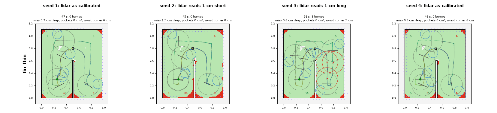
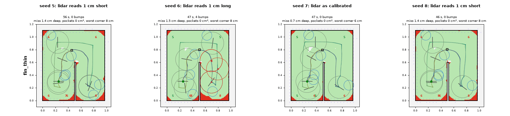
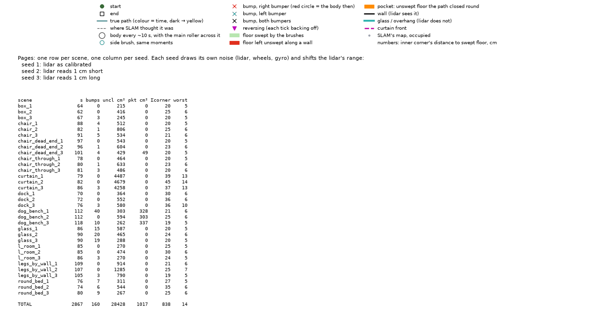
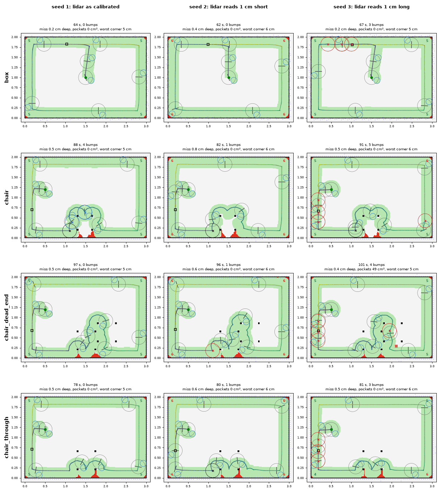
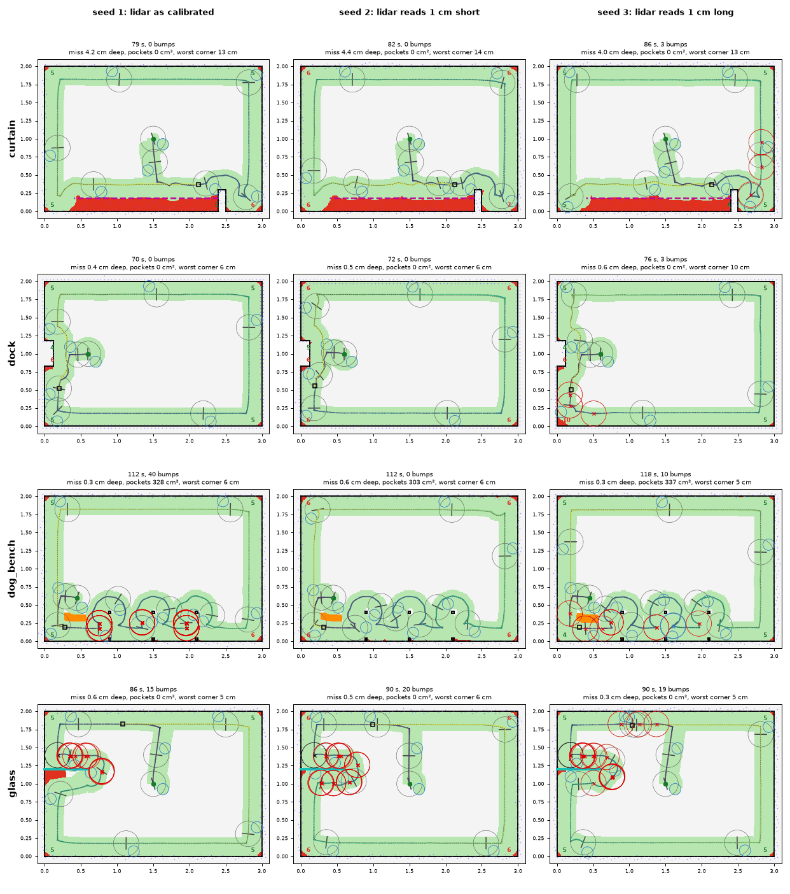
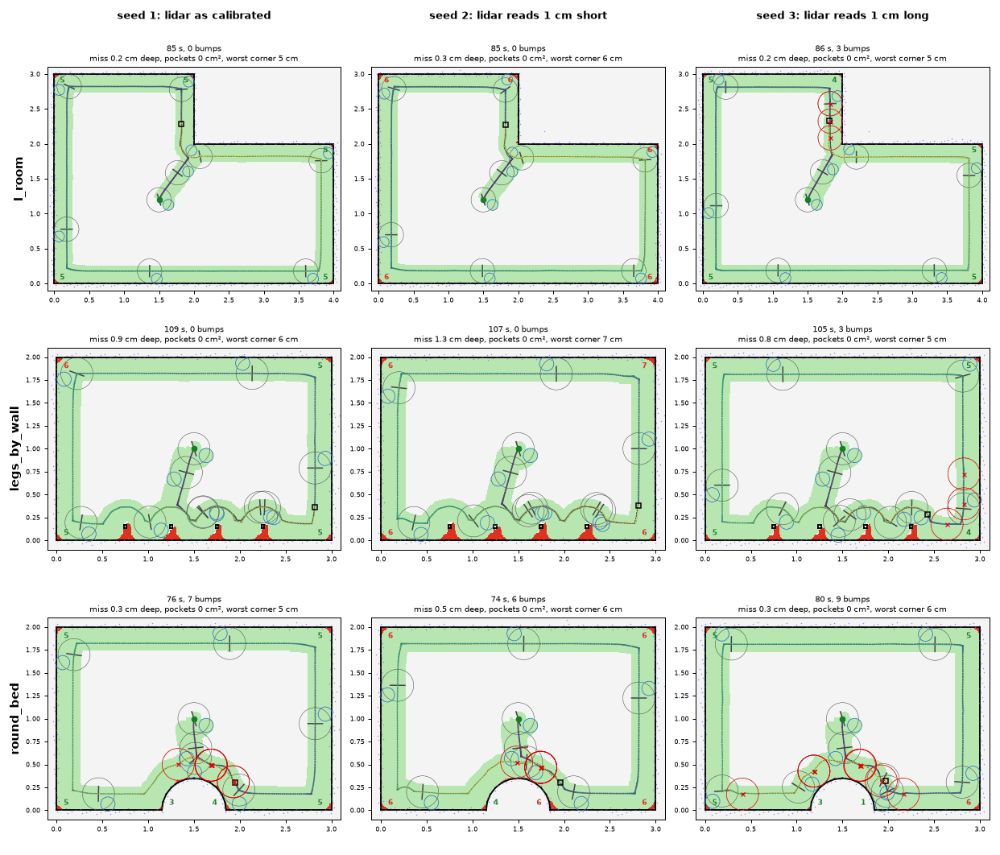
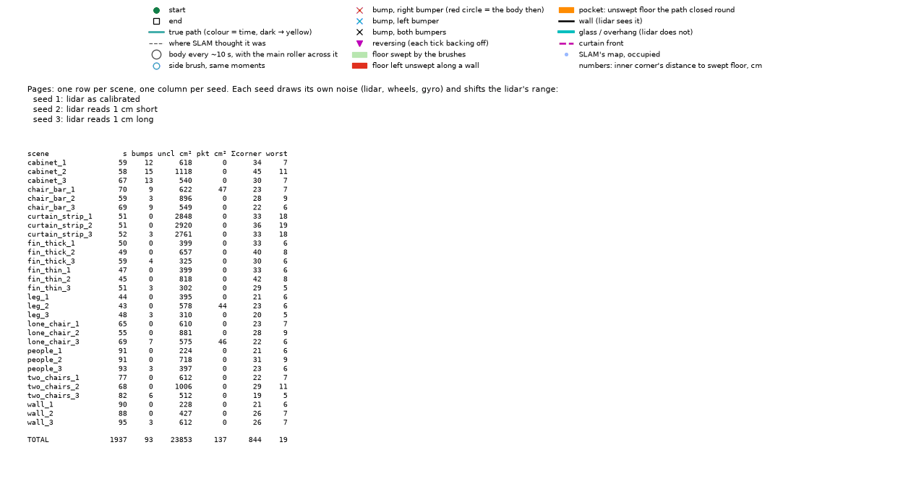
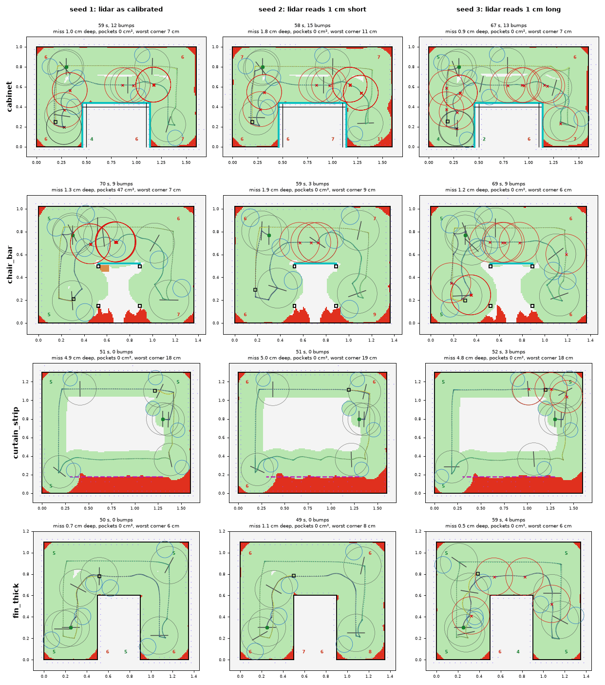
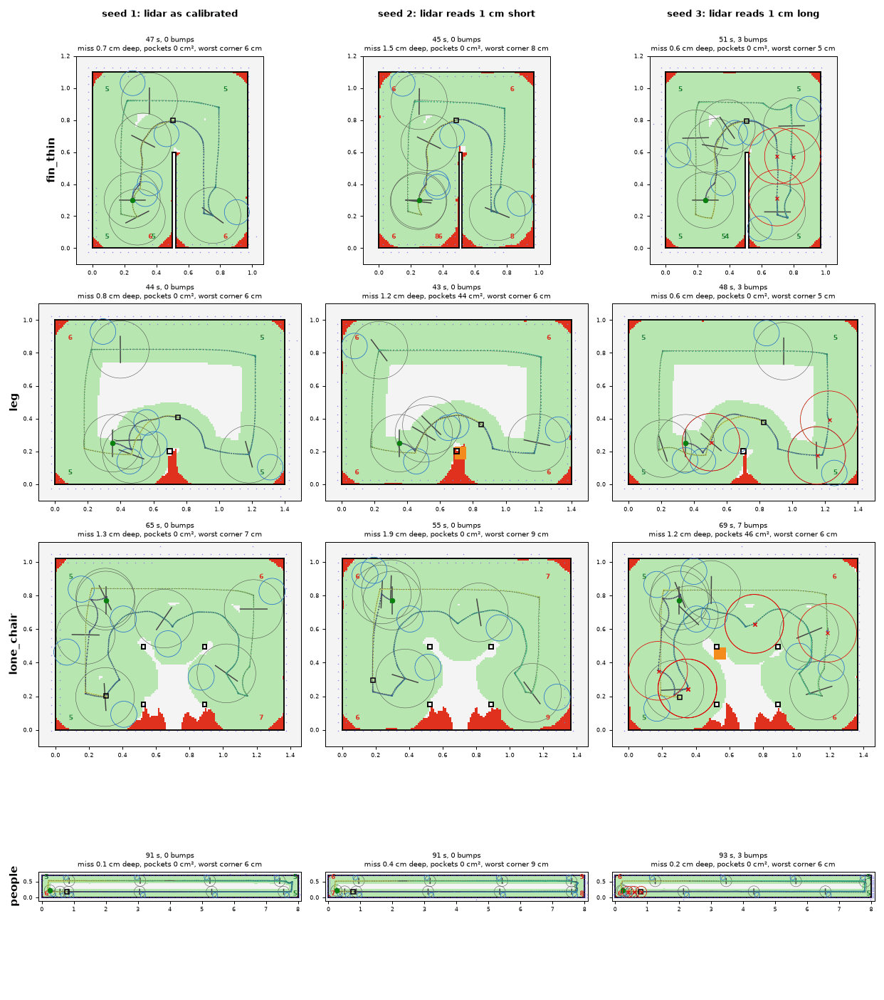
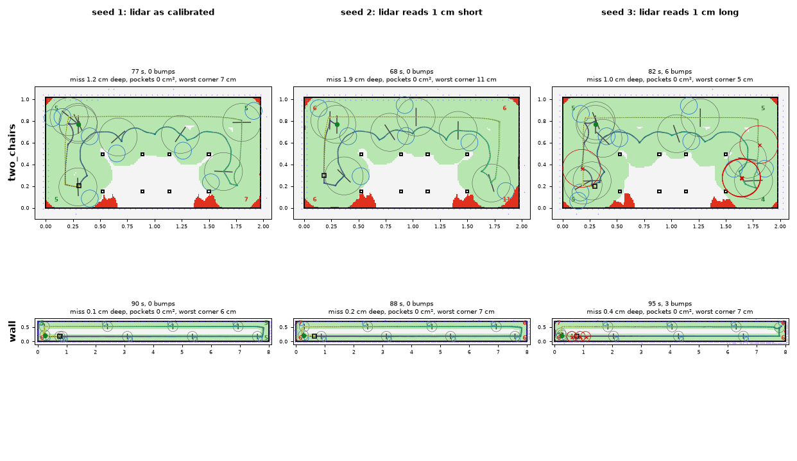

# stock_follow_fix

[stock_follow](stock_follow.md) with two changes, same code (`StockFollowConfig.overhangs`,
`stays_loose`):

1. **A wall in front of what the lidar sees.** A bump on the wall side moves the wall-side
   gaps in by what they still read, up to 10 cm. The shift holds for 0.5 m past the last such
   bump, and it follows loose meanwhile (4b383fb). This is for overhangs, kick boards and
   glass.
2. **Once loose, loose for the run.** Whatever made it bump (range bias, baseboards) does not
   stop at a corner. Tightening again only makes it bump its way loose round every corner
   (aa6f172).

Best of the three on every kit: rooms 874.1 → **725.0**, primitives 684.7 → **556.4**. Every
scene is better than stock_follow, and bumps are 13-84% fewer.

## Numbers (8 seeds, aa6f172)

Rooms, total **725.0**:

| scene | cost | laps | s | bumps | miss cm | corner | lap% | m/min |
| --- | ---: | ---: | ---: | ---: | ---: | ---: | ---: | ---: |
| box | 27.1 | 8/8 | 65 | 0.8 | 0.29 | 5.8 | 99 | 9.17 |
| chair | 47.7 | 8/8 | 86 | 3.9 | 0.62 | 5.8 | 96 | 6.63 |
| chair_dead_end | 106.7 | 7/8 | 120 | 3.8 | 2.95 | 8.6 | 88 | 4.97 |
| chair_through | 35.5 | 8/8 | 79 | 1.5 | 0.55 | 5.8 | 97 | 7.32 |
| curtain | 87.3 | 8/8 | 82 | 0.8 | 4.26 | 13.4 | 77 | 5.97 |
| dock | 35.3 | 8/8 | 72 | 0.9 | 0.46 | 6.9 | 97 | 8.35 |
| dog_bench | 115.9 | 8/8 | 113 | 13.8 | 0.39 | 5.6 | 99 | 5.26 |
| glass | 138.1 | 8/8 | 91 | 26.4 | 0.42 | 5.7 | 98 | 6.47 |
| l_room | 32.1 | 8/8 | 86 | 0.8 | 0.24 | 5.5 | 99 | 9.63 |
| legs_by_wall | 45.3 | 8/8 | 103 | 0.8 | 1.04 | 6.6 | 93 | 5.46 |
| round_bed | 54.0 | 8/8 | 75 | 6.5 | 0.39 | 5.7 | 98 | 8.12 |

Primitives, total **556.4**:

| scene | cost | laps | s | bumps | miss cm | corner | lap% | m/min |
| --- | ---: | ---: | ---: | ---: | ---: | ---: | ---: | ---: |
| cabinet | 97.4 | 8/8 | 62 | 12.9 | 1.31 | 8.5 | 93 | 5.48 |
| chair_bar | 80.6 | 8/8 | 64 | 6.8 | 2.20 | 10.3 | 87 | 3.79 |
| curtain_strip | 91.8 | 8/8 | 51 | 0.8 | 4.94 | 18.7 | 73 | 4.97 |
| fin_thick | 39.9 | 8/8 | 53 | 1.4 | 0.86 | 7.5 | 95 | 6.51 |
| fin_thin | 38.9 | 8/8 | 48 | 0.9 | 1.07 | 7.3 | 93 | 6.21 |
| leg | 29.8 | 8/8 | 47 | 1.2 | 0.91 | 5.8 | 95 | 5.81 |
| lone_chair | 46.0 | 8/8 | 62 | 1.6 | 1.51 | 7.6 | 88 | 4.03 |
| people | 40.5 | 8/8 | 91 | 0.9 | 0.23 | 7.3 | 98 | 11.29 |
| two_chairs | 49.0 | 8/8 | 75 | 2.4 | 1.34 | 7.4 | 90 | 3.78 |
| wall | 42.5 | 8/8 | 93 | 1.2 | 0.24 | 7.3 | 98 | 11.03 |

## fin_thin

fin_thin is 48.6 for wall_follow, 44.5 for stock_follow and **38.9** here.

| seeds | lidar | bumps | miss cm | corner cm | cost |
| --- | --- | ---: | ---: | ---: | ---: |
| 1, 4, 7 | as calibrated | 0 | 0.7-0.8 | 6.4 | 2.9-3.2 |
| 2, 5, 8 | reads 1 cm short | 0 | 1.4-1.5 | 8.5 | 6.1-6.6 |
| 3, 6 | reads 1 cm long | 3-4 | 0.6-1.5 | 5.0-8.5 | 3.8-7.1 |

Staying loose takes the +1 cm seeds from 5 and 9 bumps to 3 and 4. What is left is the
range bias itself. Reading short, it keeps 1 cm farther off, and nothing in the loop
notices, since it never touches anything. Calibrating the lidar, once or online from bumps,
would make those seeds cost what the calibrated ones do: [../lidar](../lidar/README.md).

Before this round fin_thin cost 60.5. Most of the difference was the bench: its loiter
term counted the robot standing still (909f444).

## Renders (seeds 1-3)

## Where it falls short

- **Glass and the dog's bench** still bump 26 and 14 times. The shift lasts 0.5 m, and a
  glass wall is longer than that.
- **Cabinet**: 13 bumps, most along the top's lip. It moves in after each, but the lip is 68 cm
  long.
- **Range bias**: reading short is not corrected (fin_thin above).
- **Curtains**: 4-5 cm deep misses, as stock_follow.
- `chair_dead_end` closes no lap on 1 of 8 seeds.

## History

- 4b383fb: a wall the bumper finds in front of the lidar's.
- aa6f172: once loose, loose for the run.
- The bench changed under it in the same round. 5b9c521: an overhang's lip is the edge, and
  the floor under it is not floor. 909f444: loitering is the longest time sweeping nothing
  new, not time spent in a 1 m circle.
