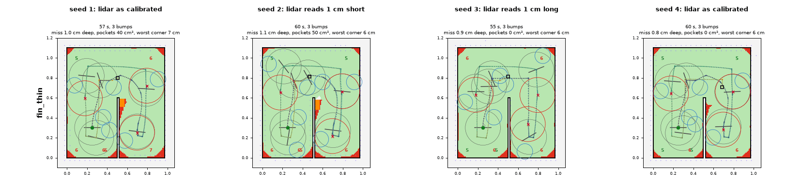
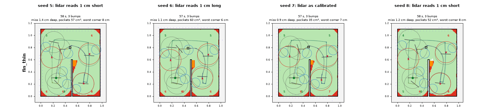
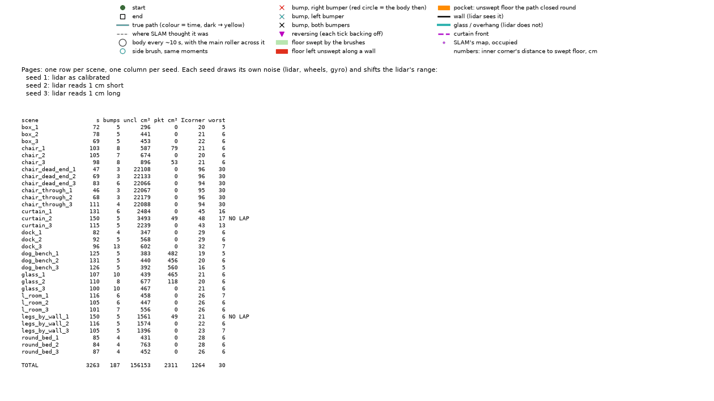
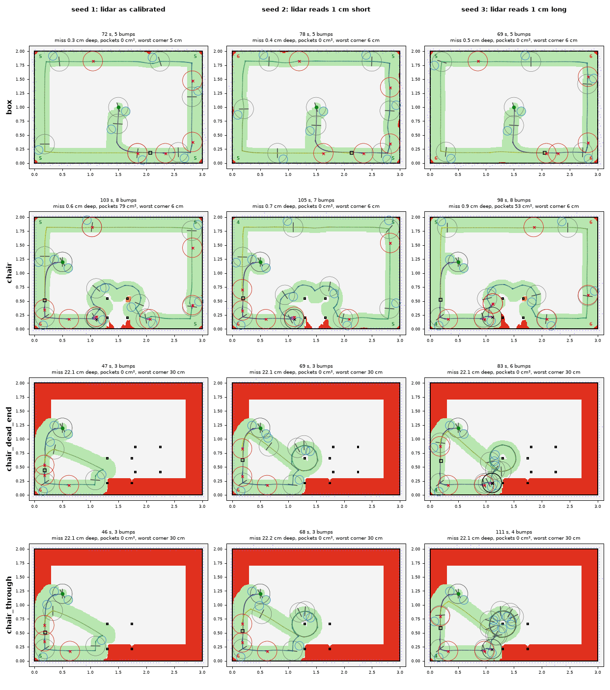
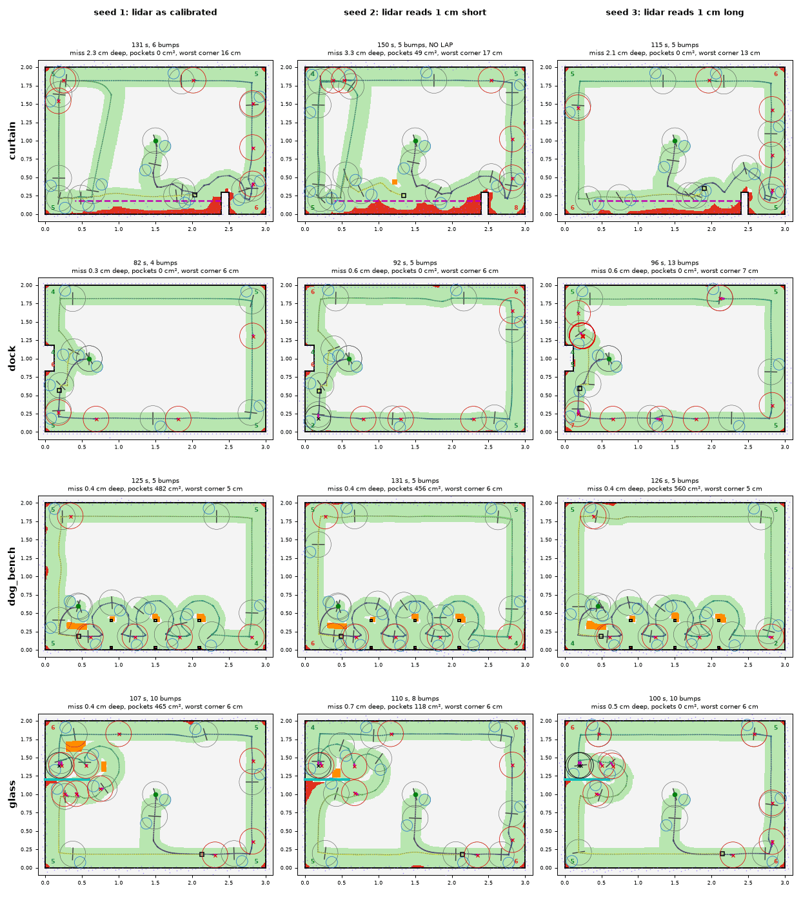
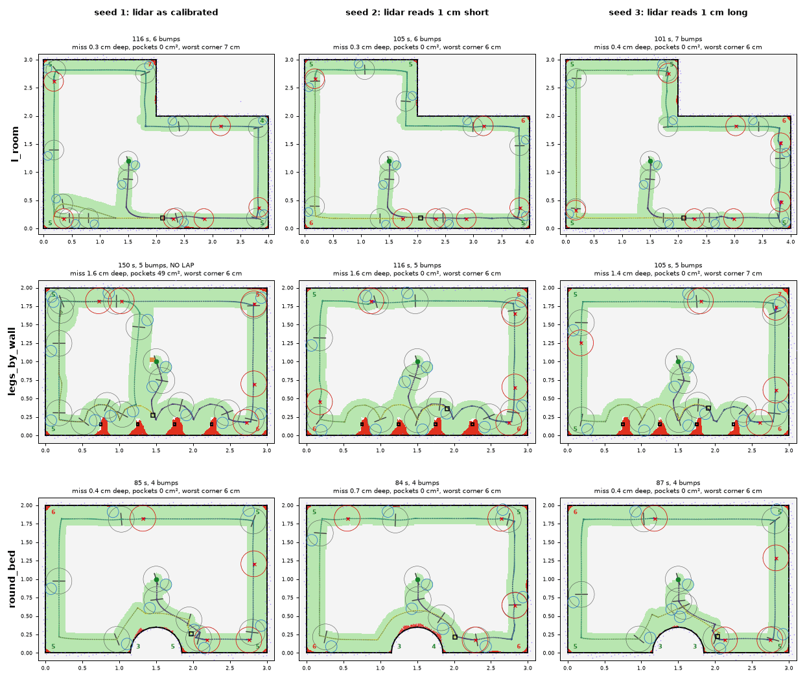
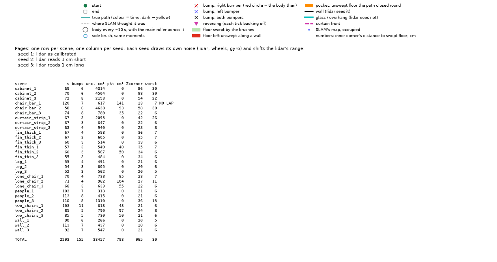
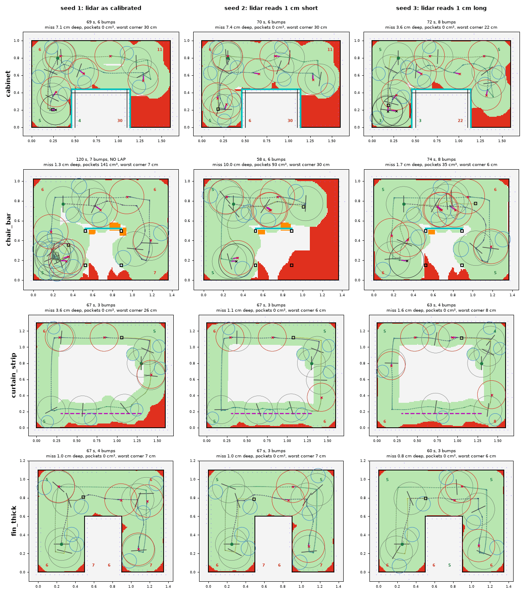
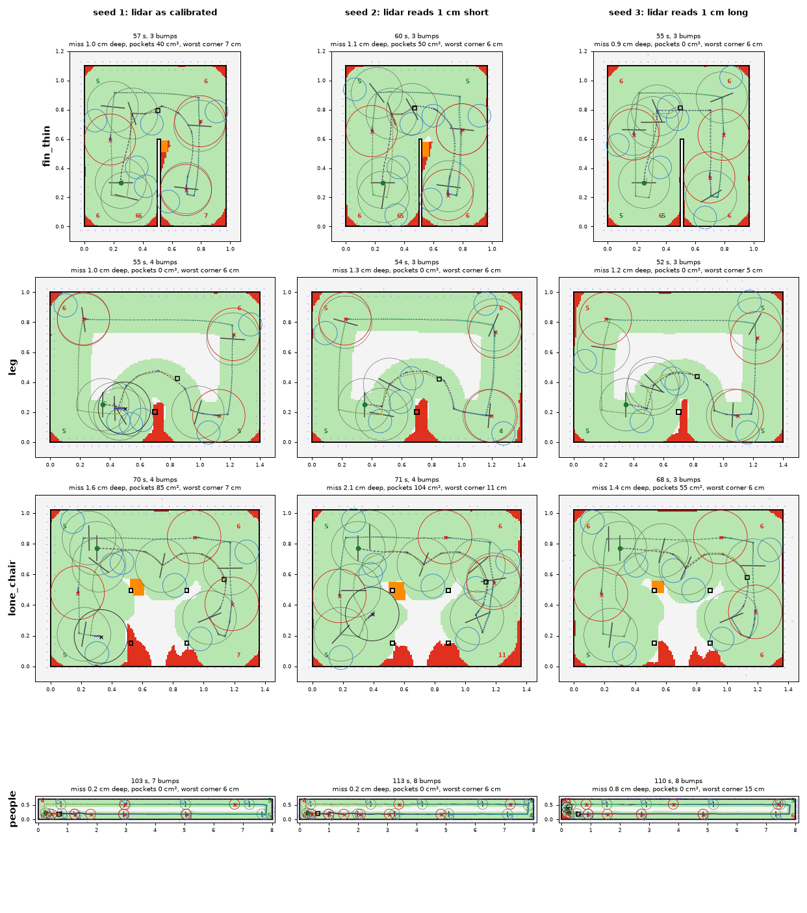
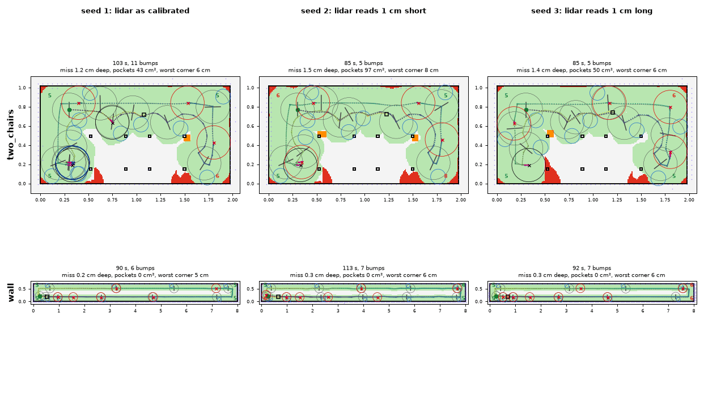

# wall_follow

Our corner sweep, `dhruva-slam/src/exploration/edge/wall_follow.rs`. One rule: keep the
nearest obstacle point on the brush side `hover_gap` beside the body. It runs along walls,
turns in inner corners and rounds outer ones. The lidar steers and the bumper corrects; a
contact the lidar cannot see (glass) is kept as a short wall for a while. Its settings are
`[exploration.wall_follow]` in `dhruva-v8.toml`, hill-climbed on this bench.

## Numbers (8 seeds, aa6f172)

Rooms, total **1563.5**:

| scene | cost | laps | s | bumps | miss cm | corner | lap% | m/min |
| --- | ---: | ---: | ---: | ---: | ---: | ---: | ---: | ---: |
| box | 44.4 | 8/8 | 74 | 5.0 | 0.36 | 5.4 | 99 | 8.03 |
| chair | 95.4 | 8/8 | 96 | 7.1 | 2.50 | 8.8 | 90 | 5.52 |
| chair_dead_end | 347.9 | 6/8 | 113 | 6.4 | 16.76 | 24.0 | 42 | 2.25 |
| chair_through | 420.7 | 6/8 | 107 | 3.4 | 22.04 | 30.0 | 24 | 1.80 |
| curtain | 144.7 | 5/8 | 128 | 5.5 | 2.48 | 12.8 | 83 | 4.23 |
| dock | 56.6 | 8/8 | 88 | 6.0 | 0.49 | 6.5 | 98 | 6.84 |
| dog_bench | 190.6 | 8/8 | 104 | 3.9 | 7.21 | 11.5 | 76 | 3.80 |
| glass | 84.6 | 8/8 | 104 | 10.0 | 0.44 | 5.4 | 98 | 5.66 |
| l_room | 57.7 | 8/8 | 105 | 6.2 | 0.33 | 5.7 | 99 | 7.95 |
| legs_by_wall | 75.5 | 7/8 | 115 | 4.6 | 1.44 | 5.9 | 92 | 4.90 |
| round_bed | 45.4 | 8/8 | 89 | 4.0 | 0.45 | 5.7 | 99 | 6.96 |

Primitives, total **821.8**:

| scene | cost | laps | s | bumps | miss cm | corner | lap% | m/min |
| --- | ---: | ---: | ---: | ---: | ---: | ---: | ---: | ---: |
| cabinet | 198.3 | 8/8 | 71 | 7.1 | 5.64 | 25.8 | 76 | 3.94 |
| chair_bar | 161.9 | 7/8 | 71 | 6.2 | 6.19 | 21.3 | 73 | 2.96 |
| curtain_strip | 66.7 | 8/8 | 71 | 3.6 | 1.89 | 11.7 | 90 | 4.43 |
| fin_thick | 46.2 | 8/8 | 64 | 3.2 | 0.84 | 6.8 | 95 | 5.47 |
| fin_thin | 48.6 | 8/8 | 58 | 3.0 | 1.05 | 7.0 | 93 | 5.14 |
| leg | 38.6 | 8/8 | 54 | 3.2 | 1.11 | 5.6 | 95 | 5.06 |
| lone_chair | 61.0 | 8/8 | 70 | 4.0 | 1.62 | 7.5 | 90 | 3.59 |
| people | 69.9 | 8/8 | 108 | 7.8 | 0.33 | 7.0 | 99 | 9.66 |
| two_chairs | 72.3 | 8/8 | 88 | 6.5 | 1.38 | 6.6 | 91 | 3.30 |
| wall | 58.3 | 8/8 | 99 | 6.9 | 0.25 | 5.7 | 100 | 10.51 |

## fin_thin

A 2 cm fin 60 cm into the room. wall_follow rounds its tip with 3 bumps on every seed and
leaves a 35-60 cm² pocket beside it on 6 of 8 seeds: the loop round the tip is wider than the
body. The range bias hardly matters to it (cost 4.9-7.3 a seed), because the bumper corrects
what the lidar gets wrong.

## Renders (seeds 1-3)

## Where it falls short

- **Chairs.** It rounds the legs as one outline and closes its lap there: `chair_through`
  sweeps 24% of the lap and `chair_dead_end` 42%.
- **Cabinet.** `cabinet` misses 5.6 cm deep with 26 cm corners: it cuts across the bay to the
  right of the cabinet instead of going into it.
- `dog_bench` leaves pockets between its legs; `curtain` runs out of time on 3 of 8 seeds, and
  its corner at the curtain's end stays about 13 cm.
- Bumps everywhere (3-10 a scene): the bumper is part of how it follows.

## History

wall_follow.rs is unchanged since baa90b4; the numbers above are from the bench at aa6f172.

- 9acfc67: edge passes go one seam past the lap's start; the strategy is a typed enum.
- baa90b4: a turn on the spot keeps the direction it started in.
- The climb before these, from cf89f9e back, is in SWEEP_BENCH.md §8.
